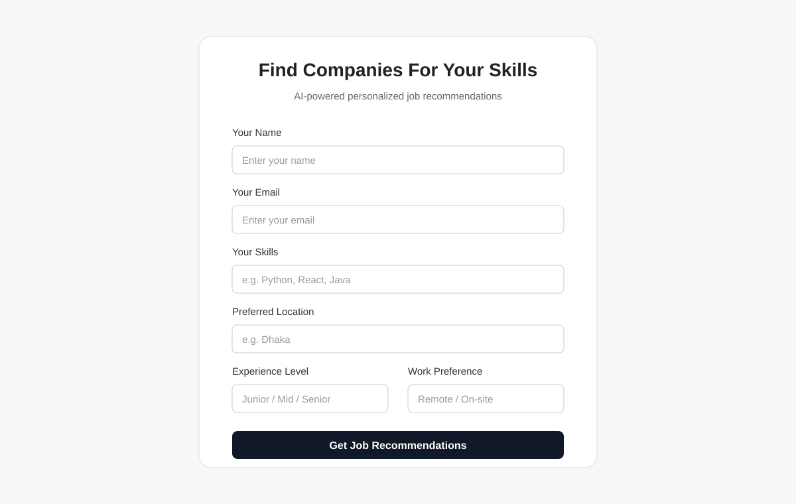
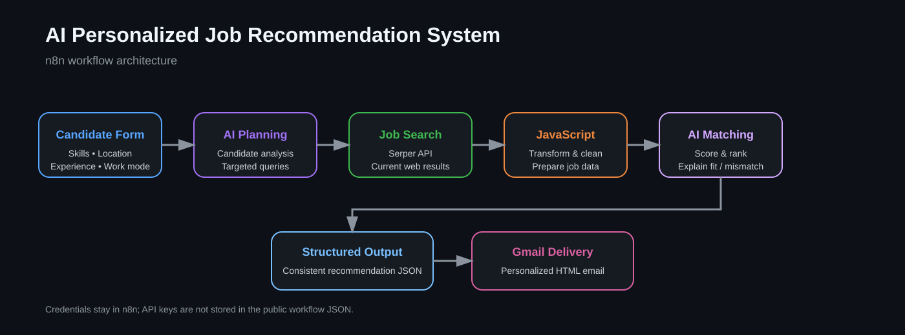
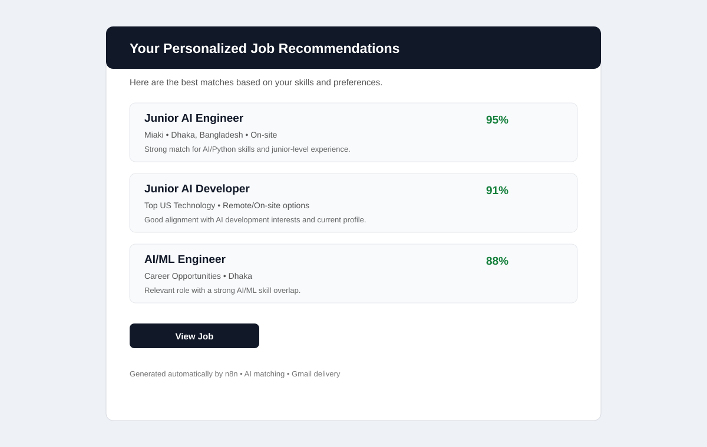

# AI Personalized Job Recommendation System

An n8n-based AI workflow that collects a candidate profile, generates targeted job-search queries, searches current job listings, ranks opportunities with AI, and delivers personalized recommendations by email.

## Live Demo

**n8n Form:** https://sakibn8n.app.n8n.cloud/form/d8576904-4058-402e-a35f-932e4f406800

> The demo asks for name, email, skills, preferred location, experience level, and work preference.

## Project Preview

### Candidate Input



### Workflow Architecture



### Recommendation Email



## Workflow

```text
Candidate Form
      ↓
AI Job-Search Planning
      ↓
Structured Search Queries
      ↓
Google Search via Serper API
      ↓
JavaScript Result Processing
      ↓
AI Job Matching & Ranking
      ↓
Structured Recommendations
      ↓
HTML Email Generation
      ↓
Gmail Delivery
```

## What it does

1. Collects a candidate profile through an n8n form.
2. Uses an LLM to generate 3–5 targeted job roles and search queries.
3. Searches for current job listings through the Serper API.
4. Processes search results with JavaScript.
5. Uses AI to rank the available jobs from best to worst match.
6. Produces a match score, reason, concern/mismatch, and job link.
7. Generates a clean HTML email containing the top recommendations.
8. Sends the recommendations automatically to the candidate.

## Tech Stack

- **n8n** — workflow automation
- **OpenRouter / LLM** — job-search planning and job matching
- **Serper API** — Google search results
- **JavaScript** — data transformation and email generation
- **Structured Output Parser** — consistent AI JSON output
- **Gmail** — personalized email delivery

## Repository Structure

```text
ai-job-recommendation-n8n/
├── README.md
├── workflow/
│   └── n8n-job-recommendation-sanitized.json
└── docs/
    ├── architecture.svg
    ├── form-preview.svg
    ├── email-preview.svg
    ├── workflow-preview.svg
    ├── architecture.md
    └── setup.md
```

## Setup

### 1. Import the workflow

Import `workflow/n8n-job-recommendation-sanitized.json` into n8n.

### 2. Configure credentials

The repository intentionally does **not** contain API keys or OAuth secrets.

Configure these credentials in your own n8n instance:

- OpenRouter API credential
- Serper API Header Auth credential
- Gmail OAuth2 credential

For Serper, the HTTP Request node expects the API credential as an HTTP header named `X-API-KEY`.

### 3. Test the workflow

Submit the form with a test candidate profile and verify:

- job-search queries are generated;
- search results are returned;
- AI recommendations are created;
- the final email is delivered.

## Security

**Never commit real API keys, OAuth tokens, passwords, or other secrets to GitHub.** Keep credentials inside n8n Credentials or another secret-management system.

The workflow file in this repository is sanitized: credential objects and deployment-specific credential metadata have been removed. You must configure your own credentials after importing it.

## Current Version

**v1.1** — secure Serper credential configuration and updated AI output-token settings.

## Future Improvements

- Better job-source filtering
- Duplicate-job detection
- More accurate ranking and scoring
- Job freshness filtering
- Application tracking
- Saved candidate profiles
- Additional delivery channels such as Slack or Telegram

## Author

**Sakib**

Built as a practical AI + workflow automation project using n8n.